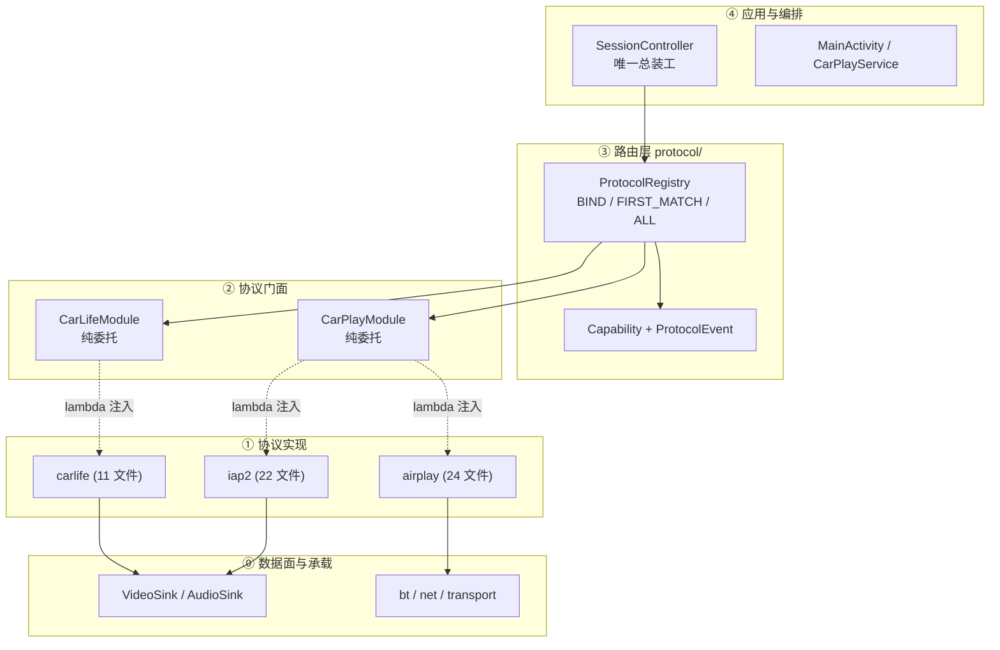
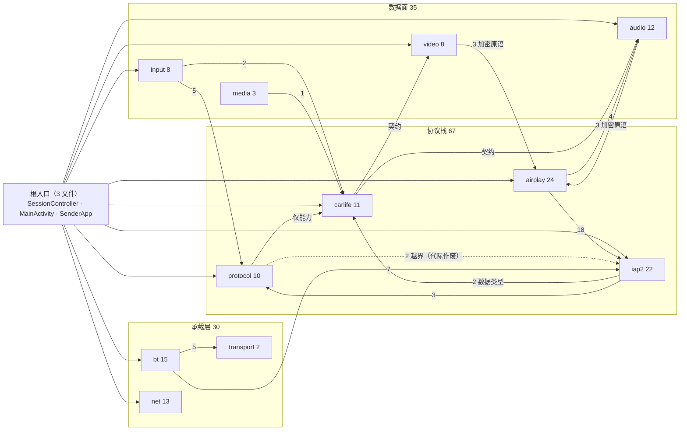
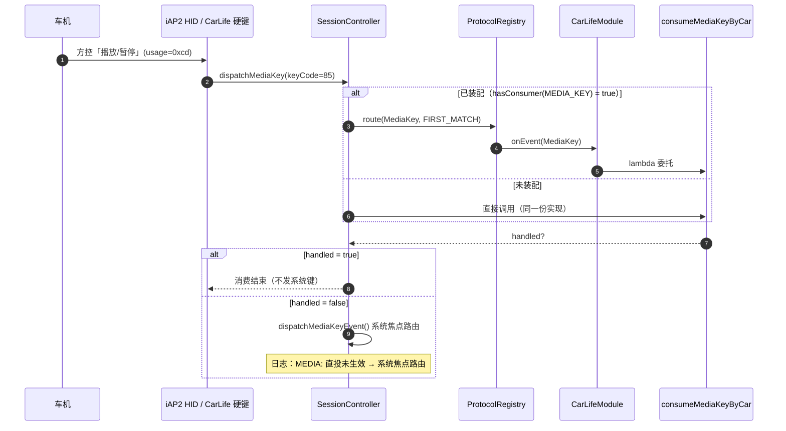
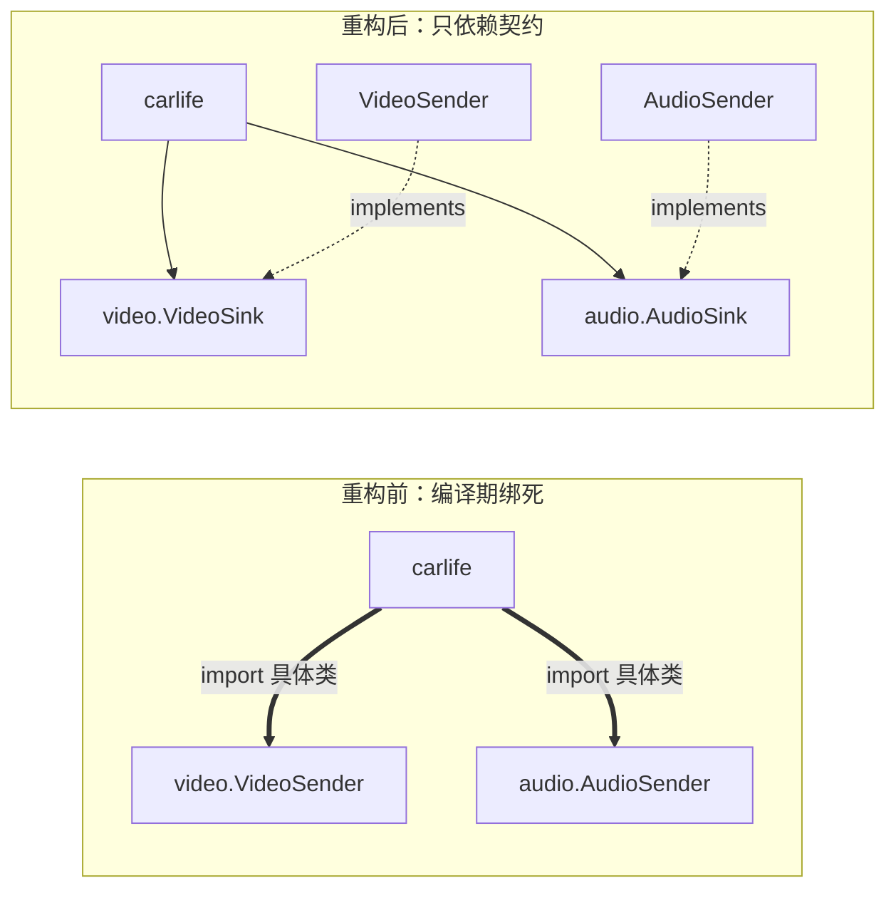

# 协议模块化重构（2026-11-19，已并入 `main`）

> **一句话结论**：`carlife` / `iap2` / `airplay` 三个协议包不再互相**调用**，跨协议交互一律经
> `ProtocolRegistry` 按**能力**接线；控制面四条入口（媒体键 / 语音键 / 触摸 / 播放意图）与数据面
> 两条契约（`VideoSink` / `AudioSink`）已收口，新增第三种协议只需声明能力、不必改调用方。
>
> 措辞要精确：跨包 `import` 并没有降到零——`iap2/NowPlayingSourcePolicy` 仍共享 `carlife` 的两个
> **数据类型**（`CarLifeMediaInfo` / `LyricLines`），`protocol/ProtocolGeneration` 仍 `import` `iap2`
> 的两个工具类。两处都是数据/工具引用，不含行为耦合，清单见 §3.1。
>
> **状态**：🧩 已实现，926 例单测全绿；控制面四条是**行为等价**改造（只换入口、不挪时序），
> **尚未逐项实车验证**——验证清单见 §14。合并方式：`main` 由 `95f8b6b` **快进**到 `be02fdc`，
> 无 merge commit；替换前的 `main` 完整备份在 `backup/main-pre-protocol-20261119`。

---

## 1. 规模与落点

| 项 | 重构前（`95f8b6b`） | 重构后（`be02fdc`） |
|---|---|---|
| 主源码 Kotlin 文件 | 169 | **180** |
| `protocol/` 包 | 2 文件（代际 / 审计） | **10 文件 / 829 行**（+8 文件） |
| 单测文件 / 用例 | 118 / 900 | **120 / 926**（`protocol/` 新增 4 文件 40 例） |
| 提交数 | — | 10（1 次快进并入 `main`） |
| 代码增量 | — | `app/` 24 文件 **+1517 / −57** 行；含文档共 35 文件 +2036 / −78 |

十个提交（按时间）：

| 提交 | 内容 |
|---|---|
| `3c74428` | 阶段 1：抽象层与聚合 `Registry` |
| `9492a57` | 阶段 2：`H264Sps` 移入 `video/`，解除 `carlife ↔ video` 类环 |
| `28bf7b9` | 阶段 3：`CarPlayModule` / `CarLifeModule` 纯委托门面 |
| `d09c853` | 文档分层整理（docs 三入口 + 体检报告） |
| `68b0c00` | 阶段 4：媒体键走能力路由 |
| `9df34e0` | 阶段 5：语音键 + 触摸走能力路由 |
| `c583fea` | 数据面抽 `VideoSink` / `AudioSink` 契约 |
| `0268578` | 播放意图走能力路由；GPS 明确不接 |
| `a033c9c` | 文档同步四条收口与数据面契约 |
| `be02fdc` | 媒体键不再依赖「通知监听器被绑上」（会话轮询兜底） |

---

## 2. 为什么要改：三个具体痛点

不是「架构不优雅」，是三个会直接制造回归的结构问题：

| 痛点 | 证据 | 现在 |
|---|---|---|
| 协议包互相 `import` | `carlife` 直接持有 `VideoSender` / `AudioSender` **具体类**，等于编译期绑死 AirPlay 发送实现 | 只依赖 `video.VideoSink` / `audio.AudioSink` 两个极小契约 |
| 类级循环依赖 | `carlife` 用 `H264Sps`、`video` 又依赖 `carlife` 的解析结果 → `carlife ↔ video` 成环 | `H264Sps` 归位到 `video/`，环解开 |
| 入口写死「三段式」 | 媒体键、语音键、触摸各自在 `SessionController` 里手写一条 if/else 分支，加第三种协议要动三处 | 入口只问 `ProtocolRegistry.hasConsumer(...)`，动作由门面提供 |

目标只有一句：**换协议不改调用方**。非目标也明确：不重写协议实现、不动报文时序、不拆
`SessionController`（见 §13）。

---

## 3. 分层结构



关键在 **③ 与 ②**：应用层只认识 `Capability`，门面只认识 lambda，两者都不认识协议实现类。

### 四条硬性约束（违反即破坏设计）

| 约束 | 现状 |
|---|---|
| `protocol/` 不得 `import` 协议实现 | ⚠️ 仅 `ProtocolGeneration.kt` 还依赖 `iap2` 的 `MfiLengthMemory` / `ReceiverProfile`（换代要作废旧参数档，属功能刚需，见 §13） |
| 门面不持有状态 | ✅ 两个门面构造参数全是 lambda，没有一条 `import` 触及 `iap2` / `airplay` / `carlife` / `bt` / `net` |
| 装配路径与本地路径**互斥** | ✅ 四处门控都用 `hasConsumer(...)`（媒体键 / 语音键 / 播放意图在 `SessionController`，触摸在 `TouchRouter`），同一份实现被两条路径共用，按键只被消费一次 |
| 事件不回流产出方 | ✅ `route()` 内 `filter { it.id != event.from }`，防止环形投递 |

### 3.1 包级依赖实测（图 + 表）

把每个 `.kt` 的 `import` 按包统计后画出来的**真实**形状（数字 = import 行数，只列 ≥ 2 的边，
根入口 `SessionController` / `MainActivity` / `SenderApp` 的边单独说明）：



| 依赖方向 | 行数 | 性质 | 判断 |
|---|---|---|---|
| 根入口 → 几乎所有包 | 9～15 每条 | 编排 | 预期内；`SessionController` 仍是唯一总装工（§13） |
| `airplay` → `iap2` | 18 | iAP2 会话由 AirPlay 会话驱动 | 预期内（AirPlay 是主会话） |
| `iap2` → `carlife` | 2 | **仅数据类型** `CarLifeMediaInfo` / `LyricLines` | 可接受；要彻底断，把两个 data class 提到独立包 |
| `protocol` → `iap2` | 2 | 换代要作废旧参数档（`MfiLengthMemory` / `ReceiverProfile`） | 唯一越界，功能刚需（§13） |
| `video` / `audio` → `airplay` | 3 / 3 | 加密原语（`AirPlayCrypto` / `StreamFrameCipher`） | 预期内：它们本来就是 AirPlay 的发送端实现 |
| `carlife` → `video` / `audio` | 3 / 4 | **只到契约**（`VideoSink` / `AudioSink` / `H264Sps`） | 本次重构的成果 |
| `bt` → `iap2` / `transport` | 7 / 5 | 承载层提供链路 | 预期内 |

结论：包级**环**只剩三处——`airplay ↔ audio`、`airplay ↔ video`（发送端用它的加密原语）、
`iap2 ↔ protocol`（代际作废）。三处都是「数据/工具」方向，没有「A 调 B 的业务流程」，所以本轮
不再拆；真要清环，第一步是把 `protocol` 的代际工具移出 `iap2`。

---

## 4. 四个核心类型

```kotlin
// 身份：谁在说话
enum class ProtocolId { CARPLAY, CARLIFE, SYSTEM }

// 路由键：交换的是什么（用功能命名，不用报文号）
enum class Capability {
    VIDEO_SOURCE, AUDIO_SOURCE, MEDIA_LYRICS, MEDIA_INFO,
    MEDIA_KEY, VOICE_KEY, GPS, PLAYBACK_INTENT, TOUCH,
}

// 事件体：只放值类型，单测可纯 JVM 跑
sealed class ProtocolEvent {
    abstract val from: ProtocolId
    data class MediaKey(...) : ProtocolEvent()
    data class VoiceKey(...) : ProtocolEvent()
    data class Touch(...) : ProtocolEvent()
    data class PlaybackIntent(...) : ProtocolEvent()
    // 另有 Gps / MediaInfo / Lyrics 三个数据类，已定义但控制面暂未接线（见 §11）
}

// 门面：声明能力 + 收事件
interface ProtocolModule {
    val id: ProtocolId
    fun provides(): Set<Capability>
    fun consumes(): Set<Capability>
    fun onEvent(event: ProtocolEvent): Boolean
}
```

`Capability` 刻意用**功能**而不是消息号命名：CarLife 的语音键是 `0x68008`，CarPlay 的语音键走
iAP2 事件通道，两条链路报文完全不同，但对聚合层来说都是 `VOICE_KEY` 这一种交换。

---

## 5. 三条投递语义

| 策略 | 语义 | 典型场景 | 代码位置 |
|---|---|---|---|
| `BIND` | 按「提供者 → 消费者」配对投递，取第一个消费者 | 源汇配对（画面 / 音频） | `ProtocolRegistry.route` |
| `FIRST_MATCH` | 按能力找消费者，**第一个认领即停** | 控制竞争（媒体键 / 语音键 / 触摸） | 同上，默认值 |
| `ALL` | 广播给所有消费者，返回值不过滤 | 状态广播 | 同上 |

`route()` 的返回值带 `handled`：`FIRST_MATCH` 下它决定「还要不要走后面的兜底」，这是媒体键三段式
兜底能保留的前提。

---

## 6. 能力矩阵：谁产出、谁消费

| 能力 | 产出方 | 消费方 | 是否事件化 |
|---|---|---|---|
| `VIDEO_SOURCE` | `carlife` | `airplay`（`VideoSink`） | 走数据面契约 |
| `AUDIO_SOURCE` | `carlife` / 系统媒体 | `airplay`（`AudioSink`） | 走数据面契约 |
| `MEDIA_INFO` | 系统媒体会话（`media/`） | iAP2 `0x5001` | 走全局状态 `pushNowPlayingAll()` |
| `MEDIA_LYRICS` | `carlife` | iAP2 NowPlaying | 同上（刻意不单独建事件） |
| `MEDIA_KEY` | 车机（HID / iAP2） | `carlife` | ✅ `ProtocolEvent.MediaKey` |
| `VOICE_KEY` | 车机事件通道 | `carlife` | ✅ `ProtocolEvent.VoiceKey` |
| `TOUCH` | 车机 HID | `carlife` `9340` | ✅ `ProtocolEvent.Touch` |
| `PLAYBACK_INTENT` | 系统媒体会话 | `airplay` 音频流 | ✅ `ProtocolEvent.PlaybackIntent` |
| `GPS` | 车机 | `carlife` `0x18010` | ❌ 刻意不接（见 §11） |

---

## 7. 控制面：四条已收口

共同点：**输入状态机留在原处，只把「判定完的动作」投出来**，所以换入口不改时序。

| 事件 | 上游状态机（不动） | 动作入口 | 共用实现 |
|---|---|---|---|
| 媒体键 | `MediaSessionsState` + `MediaKeyRoute` 白名单 | `dispatchMediaKey` | `consumeMediaKeyByCar` |
| 语音键 | `VoiceKeyRouter`（边沿 / PTT 收尾 / 三连击） | `dispatchVoiceHardKey` | `sendVoiceHardKey` |
| 触摸 | `TouchRouter` 槽位分流 | `dispatchTouch` | `CarLifeHijack.handleTouch` |
| 播放意图 | `AudioIntent` 周期登记 | `onSourceAudioPlayback` | `applyPlaybackIntent` |

以媒体键为例（一次按键的完整路径）：



两条路径**互斥**且共用同一份实现，所以「装配后行为变了」只可能出在两件事上：门控写反，
或事件载荷丢字段（`Touch.action:Int` 曾因此改成 `down:Boolean`）。

---

## 8. 数据面：`VideoSink` / `AudioSink`



| 契约 | 方法 | 语义 |
|---|---|---|
| `video.VideoSink` | `isRunning` / `seedCsd` / `submitH264` / `onSourceRestart` / `noteWriteStall` | 5 个方法：能不能收、怎么铺 CSD、送一帧、源重启、写阻塞上报 |
| `audio.AudioSink` | `isRunning` / `feedPcm` | 2 个方法：在不在跑、喂一段 PCM（重采样与混音在实现里） |

`submitH264` 的第三参 `sourceTimestampMs: Long?` **没有默认值**——Kotlin 的 `override` 函数不允许
默认参数，这里显式传 `null` 的 8 处调用是刻意的，别再加 `= null`。

效果：第三种协议要接管画面，实现 `VideoSink` 即可，`carlife` 一行不用改。

---

## 9. 装配点与互斥路径

唯一的装配点在 `SessionController.installProtocolModules()`（`ensureSessionObjects` 尾部调用，
App 启动即执行，不依赖车机连接）：

```kotlin
ProtocolRegistry.register(CarPlayModule(onPlaybackIntent = { media, nav, newIntent ->
    applyPlaybackIntent(media, nav, newIntent); true
}))
ProtocolRegistry.register(CarLifeModule(
    onMediaKey  = ::consumeMediaKeyByCar,
    onVoiceKey  = { keycode, _ -> sendVoiceHardKey(keycode) },
    onTouch     = { down, x, y, slot -> CarLifeHijack.handleTouch(slot, x, y, down) },
))
appendLog("PROTO: 协议门面已装配 —— ${ProtocolRegistry.all().joinToString { it.id.name }}")
```

门控模板（四条入口一致）：

```kotlin
val handled =
    if (ProtocolRegistry.hasConsumer(Capability.MEDIA_KEY)) {
        ProtocolRegistry.route(
            ProtocolEvent.MediaKey(keyCode, from = ProtocolId.SYSTEM),
            Delivery.FIRST_MATCH,
        ).handled
    } else {
        consumeMediaKeyByCar(keyCode)   // 同一份实现
    }
```

若装配日志缺席，说明 `installProtocolModules()` 没跑到——此时四条入口走的是本地路径，
功能不该有任何差别（这正是「行为等价」的判据）。

---

## 10. 模块目录（重构后的 `protocol/`）

```
protocol/
├── ProtocolId.kt         (15)   协议身份
├── Capability.kt         (43)   9 条能力
├── ProtocolEvent.kt     (102)   事件体（值类型）
├── ProtocolModule.kt     (33)   门面接口
├── ProtocolRegistry.kt  (133)   唯一装配点：三种投递 + startAll/stopAll/hasConsumer/reset
├── CarPlayModule.kt      (76)   纯委托门面（不 import 任何协议实现）
├── CarLifeModule.kt      (54)   纯委托门面
├── MediaSource.kt        (33)   源标识（MEDIA / NAV / VOICE）
├── ProtocolGeneration.kt(179)   协议代际：换代时作废旧参数档
└── ProtocolAudit.kt     (161)   跨协议一致性审计码
```

---

## 11. 刻意不接：GPS 与歌词

- **GPS**：`CarGpsFix` 有 17 个字段，单位是 CarLife 的私有约定（度 / 0.1 米 / 0.01 km/h），
  且只有 CarLife 一个消费者。做成通用事件只有两条路——把 CarLife 的单位搬进聚合层，或砍掉
  DOP / 卫星数 / UTC 时分秒让引擎拿半份快照。两条都更差，所以留在 `onCarLocation` 不动。
- **歌词 / 媒体信息**：三条来源最终都汇到 `pushNowPlayingAll()` 这个**无载荷触发**，数据从全局
  状态读，走事件只是多一次分配。等真有第二种协议要推 NowPlaying 再改。

「不接」是设计决定，不是遗漏——写在这里是为了下次不要重复讨论。

---

## 12. 接第三种协议：五步

1. 实现 `ProtocolModule`（`id` / `provides()` / `consumes()` / `onEvent()`）；
2. 在 `installProtocolModules()` 里 `register(...)`，lambda 指向现有实现或新实现；
3. 数据面若接管画面 / 音频，让发送端实现 `VideoSink` / `AudioSink`，`carlife` 不用动；
4. 控制面若接管某条入口，`hasConsumer(capability)` 会自动把车机侧事件路由过来；
5. 跑 `:app:testDebugUnitTest`——`protocol/` 的 40 例覆盖投递语义（含「事件不回流产出方」、
   `stopAll` 幂等、`reset` 清 `startedIds`），改投递逻辑必须先过这批。

---

## 13. 已知缺口（诚实清单）

| 缺口 | 现状 | 为什么先留着 |
|---|---|---|
| `SessionController` 未瘦身 | 仍是唯一总装工，78 行跨模块 `import`（`airplay`/`iap2`/`carlife`/`bt`/`net`/`video`/`audio`/`media`/`protocol` 等） | 它是真正的编排中心；拆它属于另一轮改造，本轮只做「入口不再写死」 |
| `protocol/` 仍有一处越界 | `ProtocolGeneration.kt` import `iap2.MfiLengthMemory` / `ReceiverProfile` | 换代必须作废旧参数档，这是功能刚需，硬拆会造出第三个包 |
| 导航独立流仍间接依赖具体类 | `carlife/CarLifeAudioSink` 读 `SessionController.navAudioSender`（静态类型是 `AudioSender`） | 实验特性（设置项 `NavAudioRoute`）；改成 `AudioSink` 访问器只需两行，但与本次收口无关 |
| GPS / 歌词未事件化 | 见 §11 | 设计决定 |

---

## 14. 实车验证清单（尚未逐项跑）

前 5 项都是**行为等价**验证：改动只换入口，时序不该有差别。

| # | 动作 | 预期日志 / 现象 |
|---|---|---|
| 1 | 冷启动并连车机 | `PROTO: 协议门面已装配 —— CARPLAY, CARLIFE`（启动即出现，不必连车） |
| 2 | 按车机「下一曲」 | 动作生效；**不应**出现 `MEDIA: 直投未生效 → 系统焦点路由` |
| 3 | 长按车机语音键 | `CARLIFE: 车机语音键 0x.. → 0x68008 已送达` |
| 4 | 车机触摸拖动后抬指 | 没有卡住的点（`TouchRouter` 的 UP 不能丢在空闲槽过滤之前） |
| 5 | 播放 / 暂停手机音乐 | 音频流按 `PLAYBACK_INTENT` 开 / 关，不重复协商 |
| 6 | 断连后重连 | 首帧出画，`VideoSink.seedCsd` 重放正常 |

第 2～5 项异常 → 门控写反；第 6 项失败 → 问题在数据面契约，不在路由。

---

## 15. 相关文档

- [`../README.md`](../../README.md) §七「工程结构」——**只有速览**（分组表 + 一段能力聚合说明 +
  目录树），重构正文一律以本篇为准，两边不重复维护
- [`PROJECT-STATUS.md`](PROJECT-STATUS.md) —— 项目体检：版本 / 代码规模 / 风险 / 未验证清单
- [`PROJECT-GUIDE.md`](PROJECT-GUIDE.md) —— 43 篇文档的索引与排障决策表
- [`PROJECT-GUIDE.md`](PROJECT-GUIDE.md) —— 47 篇文档状态索引与排障决策表
- [`carplay-connection-layers-20261109.md`](carplay-connection-layers-20261109.md) —— L1–L5 全局架构（协议链路视角）
- [`PROTOCOL-NOTES.md`](PROTOCOL-NOTES.md) —— 协议细节与逆向结论
